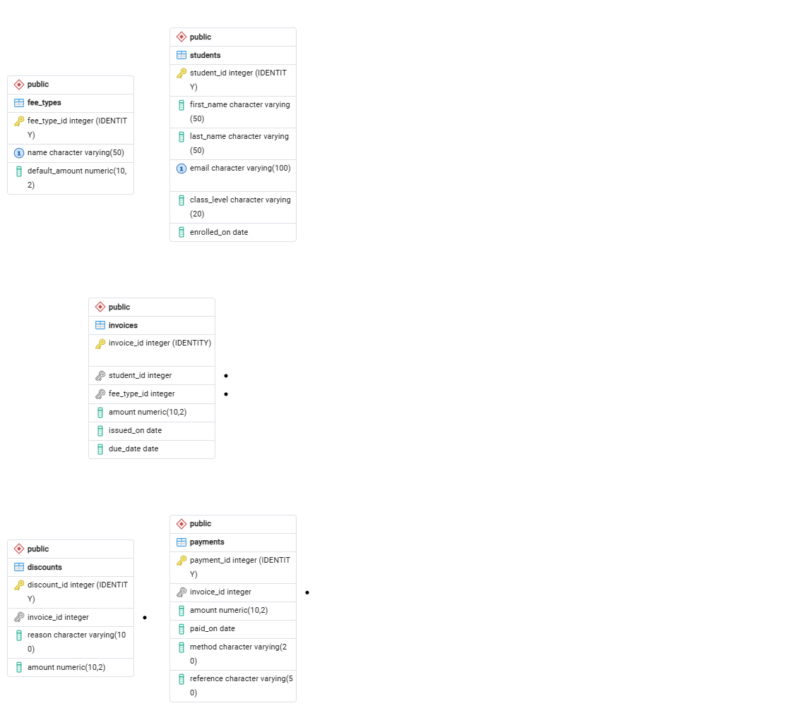

# School Fees Database

A PostgreSQL database for managing students, fee types, invoices, payments and discounts. It includes queries for unpaid fees, payment history, total collections and overdue payments.

## Entity relationship diagram

## Files

- `schema.sql`: the 5 tables and the `invoice_balances` view
- `sample_data.sql`: 10 students, 4 fee types, 20 invoices, 18 payments and 3 discounts
- `queries.sql`: 9 queries
- `query_results.md`: the output of each query
- `erd.png`: the entity relationship diagram
- `ai_data_quality_note.md`: data checks, findings and how AI was used

## How to run

1. Create a database named `school_fees` in PostgreSQL 18.
2. Run `schema.sql`, then `sample_data.sql`.
3. Run the queries in `queries.sql`.

## Design decision

Outstanding balance is calculated, not stored: invoice amount minus discounts minus payments. Storing it would let it drift out of sync with the payments table, so the payments table stays the single source of truth. The `invoice_balances` view does this calculation once, and the reports reuse it.

## Key results

- Total invoiced: 1,425,000
- Total discounts: 66,000
- Total collected: 933,000
- Outstanding balance: 426,000
- Overdue balance as of 12 Oct 2026: 341,000

## Author

Paul Oyinloye Adedayo